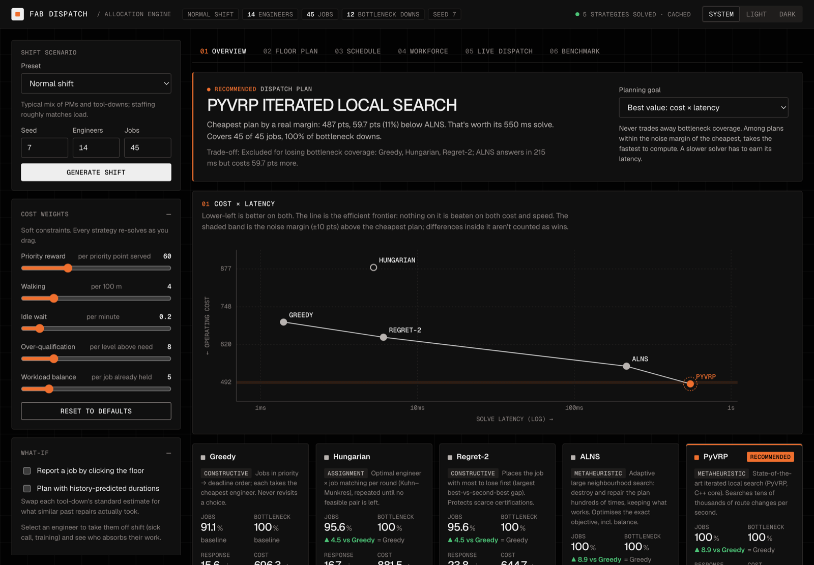
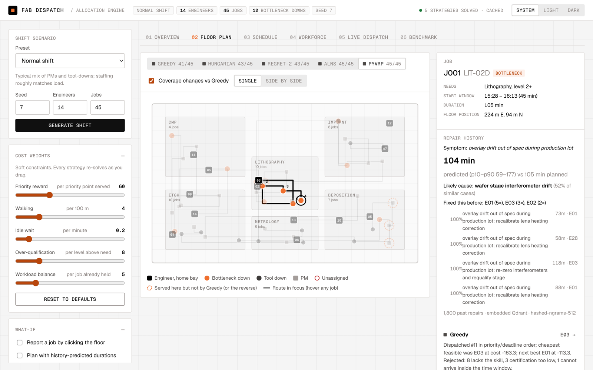
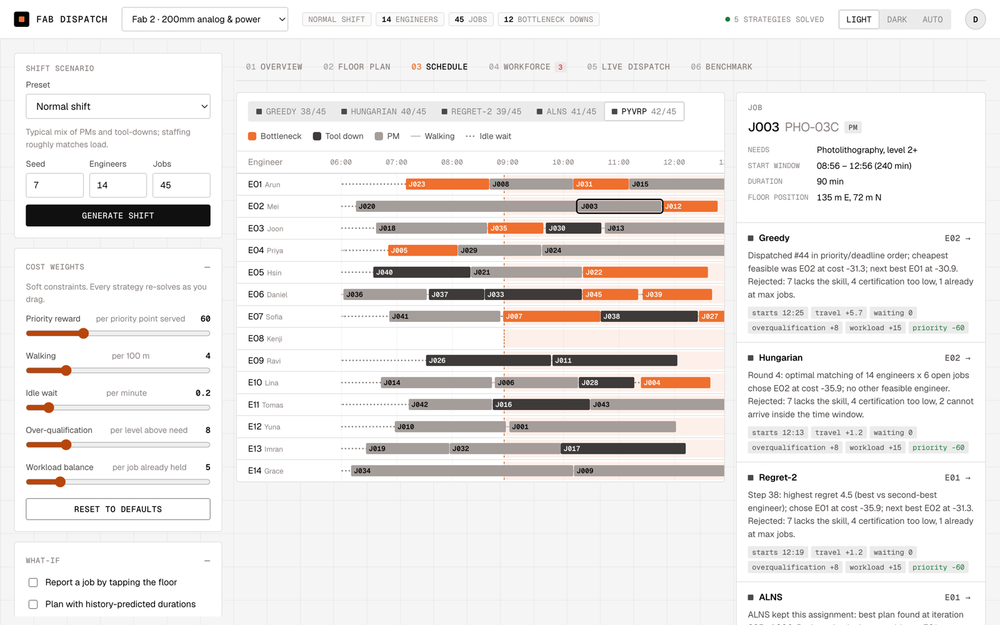
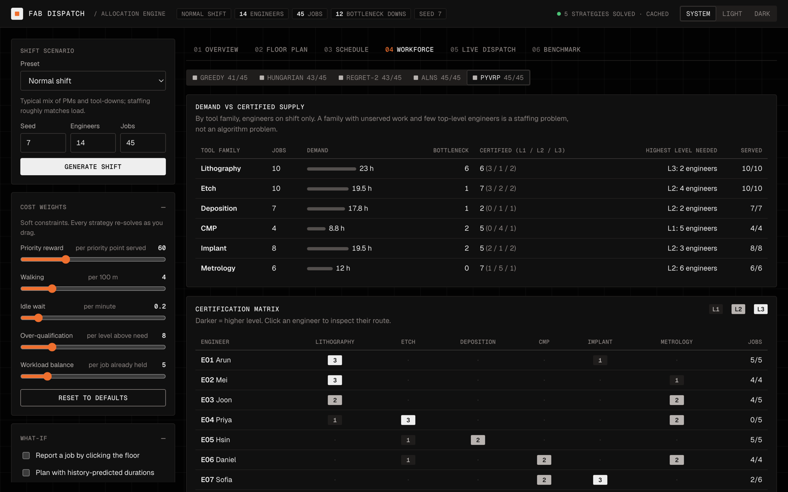
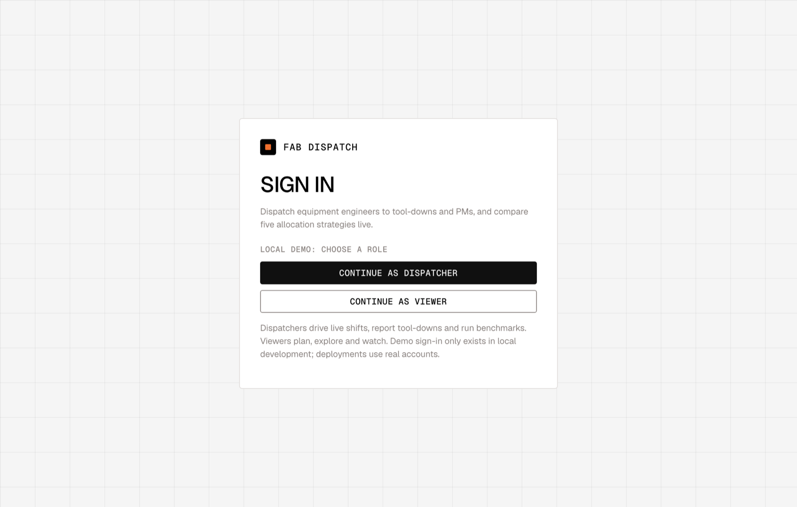
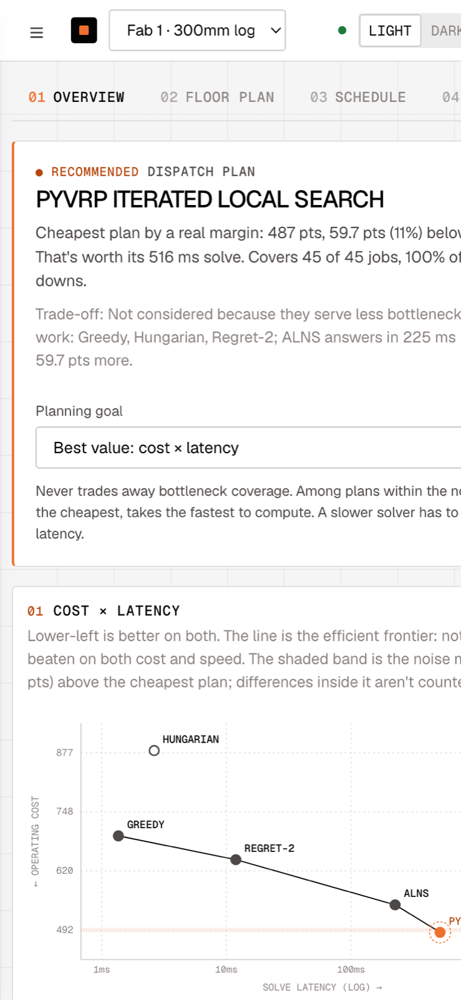
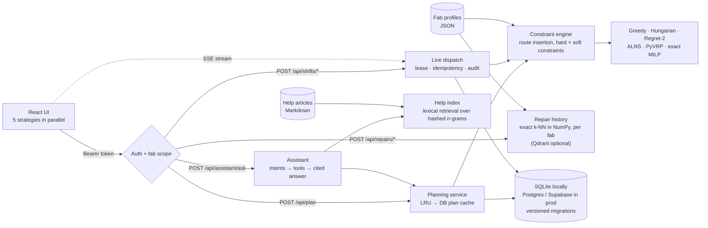

<div align="center">


# Fab Dispatch

**The right engineer to every tool-down, in real time.**<br/>
A resource allocation engine for semiconductor fab maintenance: five strategies, from a one-pass
greedy to a state-of-the-art vehicle-routing solver, compared live, with every decision explained.

<a href="https://fab-dispatch.vercel.app"></a>
<a href="https://codespaces.new/pavansky/fab-dispatch?quickstart=1"></a>
<a href="https://pavansky.github.io/fab-dispatch/"></a>

[](https://github.com/pavansky/fab-dispatch/actions/workflows/ci.yml)
[](https://github.com/pavansky/fab-dispatch/actions/workflows/codeql.yml)
[](https://pavansky.github.io/fab-dispatch/)
[](https://github.com/pavansky/fab-dispatch/actions/workflows/uptime.yml)
[](CHANGELOG.md)
[](#testing)
[](LICENSE)

[**Quick start**](#quick-start) · [**Review in 10 minutes**](https://pavansky.github.io/fab-dispatch/reviewers/) · [Requirements map](#requirements-map) · [Results](#results) ·
[Docs](https://pavansky.github.io/fab-dispatch/) · [API](https://fab-dispatch.vercel.app/api/docs) · [Support](#support)



</div>

---

## Contents

- [Why this exists](#why-this-exists)
- [Requirements map](#requirements-map)
- [Results](#results)
- [Quick start](#quick-start)
- [A 5-minute tour](#a-5-minute-tour)
- [Troubleshooting](#troubleshooting)
- [Highlights](#highlights)
- [Screenshots](#screenshots)
- [How it works](#how-it-works)
- [Testing](#testing)
- [Production readiness](#production-readiness)
- [Multi-fab and access control](#multi-fab-and-access-control)
- [API](#api)
- [Configuration](#configuration)
- [Delivery: dev → UAT → production](#delivery-dev--uat--production)
- [Project structure](#project-structure)
- [Documentation](#documentation)
- [Support](#support)
- [Limitations and roadmap](#limitations-and-roadmap)

> **Evaluating the assignment?** The first three sections answer the brief: the problem, where every
> requirement lives, and what comparing the algorithms showed. Everything after *Highlights* is
> production engineering beyond the brief: optional reading.

## Why this exists

When a lithography scanner goes down, every minute costs wafer moves. A shift lead has to decide,
right now, which engineer goes. That engineer has to be certified on the tool at the right level,
able to start within the response window, and not needed more urgently somewhere else, and the whole
floor has to stay covered for the rest of the shift.

Fab Dispatch models that decision as what it really is: a **technician routing and scheduling problem**
with skills, time windows and priorities. It solves it with five strategies, explains every
assignment, and recommends a plan using an explicit, statistically honest rule. Every fab is
described by a data profile, so the same product serves any site.

## Requirements map

Where each part of a resource-allocation brief lives, in the app and in the code.

| Requirement | In the app | In the code |
|---|---|---|
| Data model: resources, requests, assignments | Left panel and every view | `backend/app/models.py` (`Engineer`, `Job`, `Assignment`, `Route`, `AllocationResult`); persisted as an event log plus a queryable `assignments` table (`backend/app/store.py`) |
| At least two allocation algorithms | Five, side by side on **Overview** | `backend/app/algorithms/` (greedy, hungarian, regret, alns, pyvrp_ils, plus an exact MILP) |
| Hard and soft constraints | **Cost weights** sliders; rejections on **Floor plan** | `backend/app/planner.py` (one constraint engine for every strategy) |
| Decision explanations | Click any job on **Floor plan** | `backend/app/engine.py`, `algorithms/alns.py` |
| Meaningful metrics | Scorecards on **Overview**, tables on **Benchmark** | `backend/app/engine.py` (`_metrics`) |
| Tests and comparisons | (not in the UI) | `backend/tests/` (constraints, algorithms, optimality, API), `frontend/src/**/*.test.*` (components) and `frontend/e2e/` (Playwright) |
| Map / spatial view | **Floor plan** (SVG, no map service or keys) | `frontend/src/components/FloorPlan.jsx` |
| Algorithm comparison | **Overview** and **Benchmark** | `frontend/src/components/Overview.jsx`, `Benchmark.jsx` |
| Metrics display | **Overview**, **Benchmark**, **Workforce** | `frontend/src/components/MetricBars.jsx` |
| Interactive features (a plus) | Generate shifts, weights, what-if tool-downs, live dispatch, second fab | `frontend/src/components/Sidebar.jsx`, `LiveShift.jsx` |
| README and analysis | This file | [docs/ANALYSIS.md](docs/ANALYSIS.md) |
| React + FastAPI; free libraries only; runs locally without keys | Everything above | `frontend/package.json`, `backend/requirements.txt` |

## Results

80 seeded shifts (4 scenario types × 20) of 14 engineers and 45 jobs, every strategy scored by the
same engine, with paired bootstrap confidence intervals on every cost difference. The gap column
comes from solving every shift to **proven optimality**; it predates the current idle-wait model and
is marked for regeneration. Full tables and method in [docs/ANALYSIS.md](docs/ANALYSIS.md).

| Strategy | Kind | Solve time* | Lowest cost in | Gap to proven optimum† | Strength |
|---|---|---|---|---|---|
| Greedy | constructive | ~6 ms | 0 / 80 | 28.1% | Instant, simplest to explain |
| Hungarian | assignment | ~10 ms | 0 / 80 | 25.8% | Most even workload, fast response to tool-downs |
| Regret-2 | constructive | ~20 ms | 0 / 80 | 19.4% | Protects scarce certifications |
| ALNS | metaheuristic | ~0.5 s | 36 / 80 | 5.7% | Optimises the exact objective, including balance; cheapest in the litho crunch |
| PyVRP | metaheuristic | ~1.0 s | **44 / 80** | **2.7%** | Lowest operating cost in three of four presets |
| Exact | set-partitioning MILP | ~20 s (max 138 s)† | optimal | 0% | Proven optimum for planning ahead; certified bounds at larger sizes by column generation |

**At scale (measured):** the scale study plans 222 independent areas of 30 engineers × 100 jobs
(6,660 engineers on shift) in parallel and drives 50 tool-downs through the live-dispatch code;
on a 4-core container that takes 211 s wall clock (1.9 s per area, none hitting the solver's cap) and a live tool-down re-plans in 247 ms median (542 ms p95), spread over the whole shift. At 30 × 100, on one seed, PyVRP was certified within 8.4% of the optimum (old code).
Details: [ANALYSIS, "Scale"](docs/ANALYSIS.md).

\*Median of 5 runs, 14 engineers × 45 jobs, on a 4-core Intel Xeon @ 2.1 GHz container (an Apple M5
Pro laptop measured 2 / 3 / 6 / 165 / 422 ms before the idle-wait change). On Vercel's serverless
CPU, ALNS and PyVRP take about 1–3 s. A repeated plan is served from cache in under 1 ms of server
time.
†From the last full 80-shift proof, before the idle-wait change (regenerate:
`python -m scripts.benchmark --seeds 20`).

**What the comparison shows**
- With a known shift, search beats one-pass rules: PyVRP and ALNS are **8–17% cheaper** than the best
  constructive method, mostly by cutting idle wait (the one-pass rules' is 2–4× higher), and the
  difference is significant in every scenario type.
- With tool-downs revealed only as they happen (the live-dispatch replay), the methods **don't
  separate** on 5 seeds: 19 of 20 cost differences to PyVRP have a confidence interval that includes
  zero. The static benchmark assumes foresight it wouldn't have on the floor.
- Hungarian is the right choice when fairness matters most: by far the most even workload and a fast
  response to tool-downs, but it builds up the most idle time.
- When certified engineers run out, every strategy hits the same ceiling. The workforce view says so:
  it's a staffing problem, not an algorithm one.

## Quick start

| | How | Time |
|---|---|---|
| **Live** | Open **[fab-dispatch.vercel.app](https://fab-dispatch.vercel.app)** → **Try it as a guest** | 10 s |
| **In your browser** | **[Open in GitHub Codespaces](https://codespaces.new/pavansky/fab-dispatch?quickstart=1)**: installs and starts everything, nothing on your machine | ~3 min |
| **On your machine** | `git clone https://github.com/pavansky/fab-dispatch.git && cd fab-dispatch && python3 run.py` | ~3 min |

**One command, locally.** You need Python **3.11–3.14** and Node.js **20.19+**. Then:

```bash
git clone https://github.com/pavansky/fab-dispatch.git
cd fab-dispatch
python3 run.py
```

`run.py` checks your versions, installs what's missing (once), starts the API and the UI together and
opens **http://localhost:5173**. Click **Continue as Dispatcher** (a local one-click sign-in; the
server refuses it in production). **Ctrl-C** stops both. On Windows: `py run.py`.

No accounts, API keys, Docker or paid services: locally it uses SQLite (`backend/data/`) and an
in-memory vector index. Interactive API docs: http://localhost:5173/api/docs.

<details>
<summary><b>Manual steps (two terminals), and other ways to run it</b></summary>

```bash
# Terminal 1: the API
cd backend && python3 -m venv .venv && source .venv/bin/activate   # Windows: py -m venv .venv; .venv\Scripts\Activate.ps1
pip install -r requirements.txt
uvicorn app.main:app --port 8000

# Terminal 2: the UI
cd frontend && npm install && npm run dev
```

```bash
make start                       # same as python3 run.py
make check                       # everything CI checks, locally
make docs                        # build the documentation site into site/
docker compose up --build        # production-like: Postgres + Qdrant + API + nginx on :8080 (demo sign-in)
```

</details>

### Live app

https://fab-dispatch.vercel.app runs the same build on Vercel with Supabase (Postgres and Auth).

- **Try it as a guest:** one click, no email. Guests get full dispatcher access to the sample fabs.
- **Or sign in with your email:** enter it, and a one-time code (and link) arrives by email. The
  same step for new and returning users: no sign-up, no password.
  Named accounts start as **viewers**; an admin grants **dispatcher**.

Press **?** in the app for help, **/** to ask the assistant, and open **About & support** in the
user menu for the version, live status, docs and support links.

The first request after an idle spell would otherwise wait for a serverless cold start and for the
Neon database to wake, so a [GitHub Actions cron](.github/workflows/keep-warm.yml) pings the API
every five minutes. That is what keeps the first load fast; it also means the database never scales
to zero, and the app would feel slower without it.

## A 5-minute tour

1. **Overview.** The five strategies solve the same shift in parallel. The top card names the
   recommended plan and says why. The chart plots cost against solve time; the line is the efficient
   frontier. The scorecards below compare jobs served, bottleneck coverage, response, idle time and
   workload.
2. **Change the problem.** In the left panel, pick a preset (for example *Lithography crunch*), change
   engineers or jobs, and click **Generate shift**. Drag a **Cost weights** slider and every strategy
   re-solves.
3. **Floor plan** (the spatial view). Engineers, jobs and routes on the fab floor. Click a job to see
   who was assigned and why, the runner-up, why other engineers were rejected, and how each strategy
   handled it.
4. **Schedule** and **Workforce.** A timeline per engineer, and certified supply against demand per
   tool family. Workforce shows when the limit is staffing, not the algorithm.
5. **Benchmark.** Click **Run benchmark** to compare strategies over many seeded shifts, with 95%
   confidence intervals. **Measure gaps** solves small shifts exactly and shows each heuristic's
   distance from the proven optimum.
6. **Live dispatch.** Click **Start live shift**, then **Play** or **+1 h**. Turn on *Tap floor to
   report a bottleneck down* and click the floor: the plan re-optimises in under a second without
   reshuffling people. **Copy link** and open it in a second browser window: both update live.
7. **Another fab.** Switch to *Fab 2 · 200mm analog & power* in the top bar: a different floor, tool families
   and 8-hour shifts, all from a JSON profile.

## Troubleshooting

| Symptom | Fix |
|---|---|
| `Python 3.11–3.14 is required` (from `run.py`) | Install a supported Python, then run it explicitly, for example `python3.12 run.py`. |
| `Node.js 20.19+ is required` (from `run.py`), or `npm run dev` fails with a syntax or engine error | Node is too old. Install Node 22 LTS from [nodejs.org](https://nodejs.org). |
| `pip install` tries to compile numpy, scipy or pyvrp | Your Python is outside 3.11–3.14, or pip is old: `python -m pip install --upgrade pip` and retry. |
| *Can't reach the API. Is the backend running?* | Start the API (step 2 of the manual steps), or check the terminal running `run.py`. The UI proxies `/api` to port 8000. |
| `address already in use` on 8000 or 5173, or `Is port 8000 free?` from `run.py` | Another process holds the port. Stop it (`lsof -i :8000` on macOS/Linux), then restart. |
| **Run benchmark** or **Start live shift** is disabled | You're signed in as a viewer. Use the avatar menu to sign out, then **Continue as Dispatcher**. |
| You want a clean slate | Stop the API, delete `backend/data/`, start it again. |

## Highlights

- **Five strategies, one engine.** Greedy, Hungarian (Kuhn-Munkres in rounds), regret-2 insertion,
  **ALNS**, and **PyVRP** iterated local search. All share one constraint engine and cost function, so
  comparisons are fair. An **exact MILP** solver measures each heuristic's true optimality gap.
- **Recommendations that refuse false positives.** The default "best value" goal never trades away
  bottleneck coverage. It treats cost differences inside a noise margin as ties and then picks the
  fastest plan. Benchmark verdicts use paired bootstrap 95% confidence intervals.
- **Any fab, no code changes.** Floor plan, tool families, fault catalogue, shift pattern and planning
  presets live in a validated JSON profile. Two very different fabs ship today.
- **Secure and multi-tenant.** Supabase Auth in production (passwordless: an emailed one-time code, or guest access), `viewer` and
  `dispatcher` roles, per-user fab access, and a one-click demo sign-in for local development.
- **Live dispatch for a whole team.** Tool-downs arrive as the shift runs. The plan re-optimises in
  under a second without reshuffling people, and every dashboard updates over **Server-Sent Events**.
  Production behaviours included: one clock driver at a time, retry-safe actions (idempotency keys),
  presence, an audit trail, recent shifts to rejoin, offline handling.
- **Every decision explained.** For any job you can see who was chosen, the runner-up, why other
  engineers were rejected, the cost breakdown, and a **repair-history** prediction (k-NN over past repairs, with an honest "no similar history" when the symptom is vague) of how
  long the fault will take and who has fixed it before.
- **Help built in, and an assistant that cites its sources.** A searchable help center, contextual
  ⓘ links, a first-run tour and keyboard shortcuts. **Ask Dispatch** answers questions about the shift
  on screen ("why is J006 unassigned?", "how long will J006 take?") and the app, from the real plans,
  the repair index and lexical retrieval over the help articles (hashed n-grams, no learned model),
  always with sources. It says "I don't know" or "I can't do that" rather than guess: measured on an
  evaluation set in CI, end to end. Runs locally with no key; an LLM can optionally reword answers,
  and the rewrite is checked against the draft so it can't add facts.
- **Works on a phone.** The controls become a drawer, the tabs scroll, the floor plan works by touch,
  and the light theme is the default.
- **Tested at every layer.** 518 backend tests, 219 frontend component tests rendered against real API
  responses, and 29 Playwright end-to-end tests that drive the real app on desktop and on a phone,
  including WCAG 2.1 AA accessibility checks on every screen. The study scripts behind the numbers
  in [ANALYSIS.md](docs/ANALYSIS.md) are smoke-tested and coverage-counted too, and these counts
  are checked by a test, not typed in.
- **Engineered for change.** Versioned database migrations, CI with coverage, security audits and a
  Postgres matrix, a release pipeline that promotes UAT-tested commits to production, and
  post-deploy smoke tests.

## Screenshots

<table>
<tr>
<td width="50%"><br/><sub><b>Floor plan.</b> Routes along fab aisles; the selected job shows its engineer's route, how each strategy handled it, and a repair-history prediction.</sub></td>
<td width="50%"><br/><sub><b>A second fab, no code changes.</b> Fab 2 runs 8-hour shifts from 06:00 with photolithography as its bottleneck, all from its profile.</sub></td>
</tr>
<tr>
<td width="50%"><br/><sub><b>Workforce.</b> Demand against certified supply per tool family. Shows when the constraint is staffing, not the algorithm.</sub></td>
<td width="50%"><br/><sub><b>Sign in.</b> Supabase Auth in UAT and production; one-click demo roles in local development.</sub></td>
</tr>
</table>

<p align="center"><br/><sub><b>On a phone.</b> Controls in a drawer, scrolling tabs, full-width recommendation.</sub></p>

Every view has a shareable URL: `?fab=fab2-200mm-analog`, `?tab=floor`, `?job=J001`, `?engineer=E03`,
or `?shift=<id>` for a live shift.

## How it works



**The model.** Engineers start the shift at a home bay, hold certifications per tool family at levels
1–3, and can take a limited number of jobs. Jobs are tool-downs (tight response windows) or scheduled
PMs, with a priority, a duration and a symptom. Walking is Manhattan distance on the floor plan,
because fab bays sit on a grid of aisles.

| | |
|---|---|
| **Hard constraints** (never violated; tested on every strategy and every fab) | certification, level, max jobs, start window, shift end |
| **Soft constraints** (one weighted cost, adjustable live) | walking, idle wait, over-qualification, workload balance, priority reward, stability (live mode) |

**The strategies** only decide *order and scope*; the engine scores everything. That's what makes the
comparison fair. Details in [docs/ARCHITECTURE.md](docs/ARCHITECTURE.md).

## Testing

Three layers, all run in CI on every pull request (the counts below are checked by
`tests/test_release.py` against the suites, so they cannot go stale):

| Layer | Tool | Count | What it proves |
|---|---|---|---|
| Backend | pytest | **518** (the Postgres-only ones skip without `FAB_TEST_PG_URL`; 5 are slow and run on pushes to `main`) | Constraints, algorithms, optimality, API, auth, live dispatch, store and security, help, assistant quality and feedback, release consistency, the study scripts behind ANALYSIS.md |
| Frontend components | Vitest + Testing Library | **219** | Every view and flow, sign-in paths, help, the assistant and its feedback, About & support, account deletion, the crash screen, against **real API responses** |
| End-to-end | Playwright | **29** (24 desktop, 5 phone) | The real API and UI together in Chromium: two browsers on one live shift, and axe-core WCAG 2.1 AA checks on every screen and panel |

CI enforces coverage floors rather than the README quoting a figure: **92%** over the API and
its study scripts together (`--cov=app --cov=scripts`, [ci.yml](.github/workflows/ci.yml)), and
85% lines / 80% statements / 75% functions / 70% branches for the UI
([vite.config.js](frontend/vite.config.js)). The measured numbers are in every CI run's log.

```bash
# Backend (from backend/, with the virtualenv active)
pip install -r requirements-dev.txt
pytest

# Frontend unit and component tests (from frontend/)
npm test                      # or: npm run test:coverage

# End-to-end (from frontend/). Starts the API and UI by itself.
npx playwright install chromium   # once
npm run test:e2e
```

`make check` runs everything CI runs: lint, format, all three layers with coverage floors, dependency
audits and the frontend build. To include the Postgres tests locally, point `FAB_TEST_PG_URL` at any
Postgres database. `pytest -m slow` (or `make slow`) runs the slow tests: the full-size optimality
proof of every preset and the search solvers at the shipped budgets, a few minutes in all. To
reproduce every table in [docs/ANALYSIS.md](docs/ANALYSIS.md), run
`python -m scripts.benchmark --seeds 20` from `backend/` (a few minutes).

**What the tests cover**
- **Hard constraints** re-derived from scratch for every strategy, on every preset of **every fab**,
  and for the exact solver whose plans every optimality claim is measured against.
- **Optimality:** heuristics checked against the exact MILP optimum, and never allowed to beat it,
  at full shift size for every preset (the normal preset on every run, the others on pushes to `main`).
- **The evidence base:** every study script behind ANALYSIS.md (benchmark, scale, certified bounds,
  the three industrial-AI studies) runs end to end at a tiny size in the suite, with its tables
  checked for the expected keys and no heuristic beating a proven optimum.
- **Shipped budgets:** the suites run ALNS and PyVRP at a fraction of the shipped iteration budgets to
  stay fast; one slow test runs them at the real budgets on a full shift and checks feasibility,
  determinism and that more search never costs more.
- **Fab 1 golden test:** converting the hard-coded fab into a profile reproduces its scenarios byte for byte.
- **Auth:** 401 without a token, forged and expired tokens rejected, 403 for viewers on dispatcher
  actions (in the API and in the browser), 404 across fabs, demo mode refused in production.
- **Real-time:** idempotent retries, clock lease conflicts, presence, audit trail; in the browser, a
  viewer in a second window watching a dispatcher's changes arrive over Server-Sent Events.
- **UI against real data:** components render JSON captured from the API
  (`backend/scripts/export_ui_fixtures.py`). A backend test fails if the API's response shape drifts
  from those fixtures, so the UI tests can't pass against stale data (`make fixtures` refreshes them).
- **Phone layout:** the drawer, touch selection, no sideways scrolling on any view, and the user menu
  staying reachable.
- **Assistant quality:** an evaluation set of real questions, keyword phrasings and paraphrases, runs
  end to end and must cite the right article (≥ 90%; 93% today), and every off-topic question, with
  or without app vocabulary, must be declined. Answers about a job match the plans exactly. The
  optional LLM is tested to fall back to the grounded answer on any failure and on any rewrite that
  adds an id, a number or a strategy the draft didn't have.
- **Every end-to-end test fails on any browser console error.**

## Production readiness

What a production AI application needs, and where to see it here.

| Area | In place |
|---|---|
| **Access** | Supabase Auth (passwordless email code or link), `viewer` / `dispatcher` roles, per-user fab access, Cloudflare Turnstile CAPTCHA. Named users start as viewers (`FAB_DEFAULT_ROLE`) unless an admin or `FAB_DISPATCHER_EMAILS` says otherwise. On the hosted demo, one-click guests are **dispatchers by configuration** (`FAB_GUEST_ROLE=dispatcher`): they can start live shifts, drive the clock, report tool-downs and call engineers off, but only on shifts they started themselves; a real fab sets `none` or `viewer` |
| **Data security** | App tables closed to Supabase's public API (RLS on with no policies, public grants revoked); tenant isolation by fab scoping in the API and a database per fab, not by RLS. CSP, HSTS and a no-script CSP on the API, rate limits in two layers (per instance + shared counter for signed-in users), request size limits, secrets only in the platform |
| **Reliability** | Versioned migrations under a lock, optimistic concurrency, idempotent live actions, a clock lease, an SSE stream that resumes, cached plans |
| **Operations** | Health and liveness endpoints, request ids, structured logs, daily data retention, post-deploy smoke tests, an [uptime check every 30 minutes](.github/workflows/uptime.yml) that opens an incident issue |
| **Delivery** | CI on every PR (lint, 3 test layers, coverage floors, audits, accessibility, images), branch protection, actions pinned to commits, tagged releases that wait for a green UAT deployment and smoke run of that commit before promoting to production, Dependabot (pip, npm, actions, Docker) |
| **AI quality** | A grounded assistant with sources and honest refusals (lexical retrieval over hashed n-grams, no learned model), an [evaluation set](backend/tests/eval/assistant_eval.json) in CI run end to end (62/67 answerable cases cited correctly, 26/26 off-topic declined), 👍/👎 feedback with stats and an export to new evaluation cases, an [AI transparency page](https://pavansky.github.io/fab-dispatch/ai/), an optional LLM that can only reword and is checked against the draft |
| **Experience** | Light/dark themes, phone layouts, keyboard shortcuts, a first-run tour, contextual help, WCAG 2.1 AA checks, a crash screen with a prefilled report, link previews |
| **Documentation** | [Docs site](https://pavansky.github.io/fab-dispatch/) (guide, architecture, decisions, operations), [interactive API reference](https://fab-dispatch.vercel.app/api/docs), in-app help center |
| **Support** | In-app **About & support**, [Discussions](https://github.com/pavansky/fab-dispatch/discussions), issue templates, a [security policy](SECURITY.md), a [privacy page](https://pavansky.github.io/fab-dispatch/privacy/) |

## Multi-fab and access control

- **Fab profiles** (`backend/app/fabs/profiles/*.json`) describe a site: floor, tool families with bay
  areas and tool-ID prefixes, fault catalogues, shift pattern and planning presets. They are validated
  at startup and in CI. Adding a fab is a JSON file: [docs/ONBOARDING_A_FAB.md](docs/ONBOARDING_A_FAB.md).
- **Roles:** `viewer` can plan, explore and watch live shifts. `dispatcher` can also drive the clock,
  report tool-downs, take engineers off shift and run benchmarks.
- **Fab access** comes from each user's Supabase `app_metadata` (admin-controlled). Requests for a fab
  outside a user's list return 404, so one customer can't discover another's. That scoping, in the
  API, is what isolates tenants: the database's row-level security only closes the tables to
  Supabase's public API (the app connects as table owner, so no policy filters its queries).
- **Guests** (anonymous sign-in) get `FAB_GUEST_ROLE`; where that is `dispatcher`, as on the hosted
  demo, a guest can change only the live shifts it started. Named dispatchers share every shift.
- **A database per fab:** `FAB_TENANT_DATABASES` puts each fab's shifts, events, assignments and
  cached plans in its own database. CI starts one Postgres per fab and checks, by querying each
  database directly, that no fab's data appears anywhere else
  (`docker compose -f docker-compose.yml -f docker-compose.fabs.yml up` to try it). The live app runs
  this way: fab 2's data lives in its own Neon database, separate from fab 1's Supabase.

## API

Interactive OpenAPI docs at **[/api/docs](https://fab-dispatch.vercel.app/api/docs)** (ReDoc at `/api/redoc`, schema at `/api/openapi.json`). Key endpoints:

| Method | Path | Role | Purpose |
|---|---|---|---|
| `GET` | `/api/auth/config` · `POST /api/auth/demo` · `GET /api/auth/me` | public / demo / user | How to sign in, local demo sign-in, current user |
| `GET` | `/api/fabs` · `/api/fabs/{id}` | viewer | Fabs you can access, and a fab's profile |
| `POST` | `/api/scenario` · `/api/plan` | viewer | Generate a shift for a fab; plan with one strategy (cached by content) |
| `POST` | `/api/benchmark` · `/api/optimality-gap` | dispatcher | Strategy comparison across seeded shifts; exact optimum vs heuristics |
| `POST` | `/api/shifts` · `/{id}/advance` · `/{id}/jobs` · `/{id}/engineers/{eid}/off` · `/{id}/release` | dispatcher | Run a live shift (`Idempotency-Key`, `If-Match`, clock lease) |
| `GET` | `/api/shifts?fab_id=` · `/{id}` · `/{id}/events` · `/{id}/stream` | viewer | Recent shifts, state (ETag), audit log, Server-Sent Events |
| `POST` | `/api/repairs/similar` · `/api/repairs/predict-durations` | viewer | Repair-history retrieval and duration prediction |
| `GET` | `/api/help` · `/api/help/{slug}` · `/api/help/search?q=` | public | Help center: contents, an article, search |
| `POST` | `/api/assistant/ask` | viewer | Grounded answer with citations and actions, for the shift sent as context |
| `POST` | `/api/assistant/feedback` · `GET /api/assistant/stats` | viewer · dispatcher | Rate an answer; helpful rates by kind of question |
| `GET` | `/api/health` · `/api/livez` | public | Readiness (database + schema version) and liveness |

Errors share one envelope: `{"error": {"code", "message", "request_id"}}`.

## Configuration

Everything is optional locally. Variables use the `FAB_` prefix (see [.env.example](.env.example)).

| Variable | Default | Purpose |
|---|---|---|
| `FAB_AUTH_MODE` | `demo` | `supabase` in UAT/production (demo is refused there) |
| `FAB_DISPATCHER_EMAILS`, `FAB_DEFAULT_ROLE`, `FAB_DEFAULT_FABS` | `[]`, `viewer`, `["*"]` | Bootstrap dispatchers, least-privilege default, default fab access |
| `FAB_DATABASE_URL` | `sqlite:///./data/fab.db` | Postgres in production. `POSTGRES_URL` from Vercel's Supabase integration is also accepted |
| `FAB_PROFILES_DIR`, `FAB_DEFAULT_FAB` | bundled, `fab1-300mm-logic` | Where fab profiles live; the fab shown first |
| `FAB_QDRANT_URL`, `FAB_QDRANT_API_KEY` | unset (exact NumPy search) | Use a Qdrant server or Qdrant Cloud for repair history |
| `FAB_ALNS_ITERATIONS` / `FAB_PYVRP_ITERATIONS` | `300` / `1000` | Search budgets, sized from the measured quality curve |
| `FAB_TURNSTILE_SITE_KEY` | unset | Cloudflare Turnstile site key, when CAPTCHA protection is on in Supabase Auth |
| `FAB_GUEST_ROLE` | `viewer` | Role for one-click guest sign-ins (Supabase anonymous users), or `none` to refuse guests |
| `FAB_ASSISTANT_LLM` | `none` | Optional model to reword assistant answers: `anthropic` (`ANTHROPIC_API_KEY`, `claude-haiku-5-5` by default) or `ollama` (local) |
| `CRON_SECRET` | unset | Protects the daily data-retention endpoint |

## Delivery: dev → UAT → production

| | Dev | UAT | Production |
|---|---|---|---|
| Deploys | locally / every pull request (preview) | every merge to `main` | a release tag `vX.Y.Z` |
| Access | demo sign-in | Vercel login + Supabase Auth | Supabase Auth |
| Database | SQLite / schema `uat` | Supabase, schema `uat` | Supabase, schema `public` |

- **Branch protection:** `main` only accepts changes that pass CI; `production` can't be force-pushed
  or deleted, and only moves forward through a release.
- **CI** on every push and PR: ruff and ESLint, **CodeQL** security analysis, API tests with a 90%
  coverage floor on Python 3.11/3.12/3.14 and Postgres, component tests with coverage floors,
  Playwright end-to-end on desktop and phone with WCAG audits, `pip-audit` + `npm audit`,
  **dependency review** (no vulnerable or GPL-family additions), the **full Docker stack started and
  signed into**, **Trivy** image scans, **actionlint**, and Conventional Commits.
- **Release:** pushing a tag requires the commit to be on `main` before anything is published,
  re-runs CI on that exact commit, publishes **images to GHCR with an SBOM and a GitHub
  build-provenance attestation** (verifiable with `gh attestation verify`; not cosign-signed), **waits
  for a successful UAT deployment and a passing smoke run of that commit** (up to 15 minutes),
  fast-forwards `production`, **waits until production serves the new version**, then publishes
  release notes from the changelog.
- **Smoke tests** after every deployment: healthy, schema current, real auth (never demo).
- **Rollback:** promote the previous deployment in Vercel; migrations are additive so it keeps working.

Runbook: [docs/ENVIRONMENTS.md](docs/ENVIRONMENTS.md) · Hosting details: [docs/DEPLOYMENT.md](docs/DEPLOYMENT.md).

## Project structure

```
run.py                     one command: install what's missing, start API + UI, open the browser
.devcontainer/             GitHub Codespaces: the app running in your browser, nothing installed
mkdocs.yml                 the documentation site (docs/build.py generates guide, API and project pages)
backend/
  app/
    fabs/                  fab profile schema, registry, profiles/*.json
    auth.py validation.py  identity, roles, fab scoping
    models.py              domain model (pydantic)
    planner.py             constraint engine: route simulation, insertion, live freezing
    algorithms/            greedy · hungarian · regret · alns · pyvrp_ils · exact
    engine.py              run a strategy -> assignments, explanations, metrics
    live.py                rolling-horizon live dispatch, clock lease
    knowledge.py           repair history and its k-NN index (NumPy; Qdrant optional), per fab
    help/                  help center articles (Markdown) and their validation
    assistant/             grounded assistant: retrieval, intents and tools, optional LLM
    store.py               SQLite / Postgres repository + versioned migrations
    routes/                system · auth · fabs · planning · live (SSE) · repairs
  scripts/benchmark.py     reproduces every table in docs/ANALYSIS.md
  scripts/                 scale, certified-bound, duration, predictive and learned-policy studies (all smoke-tested)
  scripts/export_ui_fixtures.py   real API responses for the UI tests
  tests/                   518 tests (incl. golden fab fingerprints, UI fixture contract, assistant eval, the scripts)
frontend/src/
  App.jsx auth.jsx api.js  workspace, sign-in, API client
  lib/                     fab context, recommendation logic, statistics, progressive planning
  components/              floor plan, frontier chart, schedule, workforce, live dispatch, benchmark
  components/HelpCenter · Assistant · Tour   in-app help, Ask Dispatch, first-run tour
  test/                    fake API over real fixtures, app-level, live-dispatch, help and sign-in tests
frontend/e2e/              Playwright: planning, live dispatch, roles and fabs, help and assistant, phone
supabase/                  branded auth email templates and how to apply them
.github/                   CI, release, smoke, docs and uptime workflows, Dependabot, issue templates, CODEOWNERS
docs/                      the documentation site: quick start, reviewers' tour, AI transparency, privacy,
                           support, API reference, plus ANALYSIS · ARCHITECTURE · DECISIONS · operations
```

## Documentation

| Document | What's in it |
|---|---|
| [ANALYSIS.md](docs/ANALYSIS.md) | Benchmark, optimality gaps, budget sizing, when each strategy wins |
| [ARCHITECTURE.md](docs/ARCHITECTURE.md) | Components, auth and tenancy, live dispatch, repair history, migrations, performance |
| [DECISIONS.md](docs/DECISIONS.md) | 36 design decisions with context and trade-offs |
| [DESIGN_REVIEW.md](docs/DESIGN_REVIEW.md) | Every question a reviewer is likely to ask, answered with the evidence: model, algorithms, optimality, scale, security, testing, trade-offs |
| [ENVIRONMENTS.md](docs/ENVIRONMENTS.md) | Dev → UAT → production, releases, rollback, per-environment config |
| [ONBOARDING_A_FAB.md](docs/ONBOARDING_A_FAB.md) | Adding a new fab: profile, validation, access, release |
| [DEPLOYMENT.md](docs/DEPLOYMENT.md) | Local, Docker and Vercel + Supabase hosting |
| [CONTRIBUTING.md](CONTRIBUTING.md) | Setup, conventions, migrations, releasing |
| [Documentation site](https://pavansky.github.io/fab-dispatch/) | User guide, architecture, algorithms, decisions, operations, AI transparency, privacy, support |
| [API reference](https://fab-dispatch.vercel.app/api/docs) | Interactive OpenAPI docs (also at `/api/docs` locally) |
| [In-app help](backend/app/help/articles/) | The 17 help-center articles, readable here too |
| [supabase/README.md](supabase/README.md) | Branded sign-in emails, sender setup, guest access |
| [SECURITY.md](SECURITY.md) · [SUPPORT.md](SUPPORT.md) | Threat model and mitigations · where to get help |
| [CHANGELOG.md](CHANGELOG.md) | Release history, every version since v0.1.0 |
| [LICENSE](LICENSE) · [THIRD_PARTY_NOTICES.md](THIRD_PARTY_NOTICES.md) | MIT · the open-source software it builds on, with each license |

## Support

- **In the app:** **?** opens help, **/** asks the assistant, **About & support** (user menu) shows the
  version, live status and every link below.
- **Questions and ideas:** [GitHub Discussions](https://github.com/pavansky/fab-dispatch/discussions).
- **Bugs:** [open an issue](https://github.com/pavansky/fab-dispatch/issues/new/choose), or use
  **Report a problem** in the app, which prefills your release and browser.
- **Security:** privately, per [SECURITY.md](SECURITY.md).

More in [SUPPORT.md](SUPPORT.md) and the [support guide](https://pavansky.github.io/fab-dispatch/support/).

## Limitations and roadmap

- **Synthetic data.** Floor layouts, SLAs, skill mixes and repair histories are illustrative and seeded
  for reproducibility. Real MES events and maintenance logs would plug into `Scenario`, `report_job`
  and `RepairIndex`.
- **Deterministic durations.** The repair-history range (p10–p90) is shown but not yet planned against;
  buffering to p80 would make schedules more robust.
- **One engineer per job; no parts availability.** Both are natural extensions of the constraint engine.
  The full list of what the model leaves out (and what each omission costs) is in
  [ANALYSIS.md](docs/ANALYSIS.md), *What the model does not capture*.
- **The full-size optimality proof does not fit the hosted app.** Proving a 14 × 45 shift optimal takes
  up to about two minutes; the hosted API function is capped at 60 s (`vercel.json`), so the live app's
  *Measure gaps* only proves small shifts (4 × 12, at most 6 × 16). The full-size gaps come from
  `scripts/benchmark.py --only gaps-full` and are in [ANALYSIS.md](docs/ANALYSIS.md).
- **Enterprise SSO** (SAML/OIDC via Supabase) and **audit export** to a fab's SIEM are configuration
  and integration work, not redesign.

## License

[MIT](LICENSE) © 2026 PavanSky. Free to use, copy, modify and share, commercially too, as long as
the copyright and license notice stay with it. The libraries it builds on keep their own licenses,
all compatible with MIT: see [THIRD_PARTY_NOTICES.md](THIRD_PARTY_NOTICES.md). The data is
synthetic and covered by the same license.
