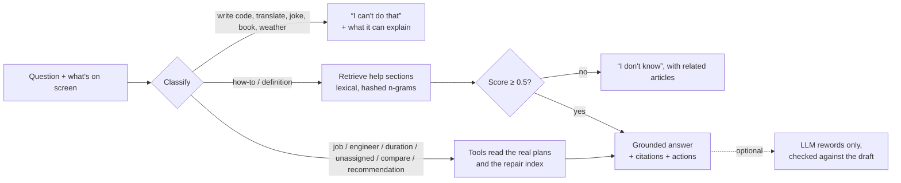

# AI transparency: the assistant and repair history

**Ask Dispatch** answers questions about the shift on screen and about the app, and **Repair
history** predicts how long a tool-down will take from past repairs. This page is their model
card: what they do, where answers come from, what leaves the server, how they're measured, and
their limits.

## What it's for

Helping dispatchers understand plans (*why is J006 unassigned?*, *what is E03 doing?*, *how long
will J006 take?*, *why is PyVRP recommended?*) and use the app (*how do I report a tool-down?*). It
reads; it never changes anything: it can't start shifts, move engineers or edit data.

## How an answer is made



1. **Understand.** Normalise ids (*job 6*, *J6* and *J006* are the same job; *E3* is *E03*), pull
   out strategy names, then classify the intent. Imperative tasks the app doesn't do (write code,
   translate, jokes, bookings, weather) are refused by rule before retrieval, because they often
   carry app vocabulary that would otherwise retrieve an article.
2. **Act with tools.** Shift questions are answered from the plans for exactly what's on screen, via
   the same cached planning service the UI uses, so the assistant and the inspector always agree.
   Duration questions call the repair index for the job's symptom. The **recommendation is
   recomputed on the server** with the same rule as the UI (`app/assistant/recommend.py` mirrors
   `frontend/src/lib/analysis.js`); the browser's `why`/`tradeoff` text is never echoed, and if the
   screen's claim disagrees with the server's pick the answer says so. App questions retrieve help
   sections.
3. **Answer, with sources.** Every answer carries citations (help sections) and actions (open a job,
   a strategy, a view). Free text from the shift (engineer names, symptoms) is stripped of control
   characters and capped before it appears in an answer.
4. **Or decline.** Below a retrieval score of **0.5**, it says it doesn't know and suggests articles.

### What retrieval actually is

Plainly: **lexical retrieval over hashed n-grams, Qdrant optional.** There is no learned embedding
model. Each help section (or glossary term) is turned into a 512-dimensional vector of hashed words,
word pairs and character trigrams (`HashEmbedder`, the same one repair history uses), stored with
qdrant-client's in-memory mode. A query fetches every point and re-scores it in Python: cosine
similarity plus an IDF-weighted share of the question's terms (after stop words, stemming, app
synonyms and phrases) found in the article's keywords, the section heading and summary, and the
section text, damped when only one word is shared. "Hybrid" means cosine over hashed n-grams plus
these keyword boosts, nothing more. Very unusual phrasing can miss; rephrasing usually helps.

Two cut-offs exist on purpose. The assistant answers **one** section as fact, so it needs a score of
**0.5**. `/api/help/search` lists candidates for a person to scan and pick from, so it shows anything
scoring **0.35** or more; a weak match in a list costs nothing, a weak match stated as the answer
would.

## Evaluation

The evaluation set ([`assistant_eval.json`](https://github.com/pavansky/fab-dispatch/blob/main/backend/tests/eval/assistant_eval.json))
runs in CI on every change, **end to end through `Assistant.ask()`**, the same path as
`POST /api/assistant/ask` without a shift on screen. An answerable case passes when the expected
article is the first citation and the answer is not a refusal; an off-topic case passes when it is
declined. It has four groups:

| Group | Cases | What it checks |
|---|---|---|
| Keyword phrasings | 42 | Questions that share a word with the target article's keyword list |
| Paraphrases | 25 | Questions written without the keyword lists: UI details, symptoms, synonyms (*what stops a plan from being picked*, *my engineer is overloaded*) |
| Off-topic | 16 | No app vocabulary (*weather in Paris*, *the moon landing*) |
| Off-topic with app words | 10 | Tasks the app doesn't do, in the app's own words (*Python code for the greedy strategy*, *a joke about the Hungarian algorithm*, *the weather in the cleanroom*) |

A test guards the method: a paraphrase may share at most one keyword with its target article, so
the set can't be made to pass by copying questions into keyword lists.

**Before and after** (same set, measured on the previous code and on this one):

| Measure | Before | After | Required |
|---|---|---|---|
| Keyword phrasings cited correctly | 42 / 42 | **42 / 42** | |
| Paraphrases cited correctly | 15 / 25 | **20 / 25** | |
| Off-topic declined | 14 / 16 | **16 / 16** | |
| Off-topic with app words declined | 3 / 10 | **10 / 10** | |
| All answerable (the CI bar) | 57 / 67 (85%) | **62 / 67 (93%)** | ≥ 90% |
| All refusals (each one a test) | 17 / 26 | **26 / 26** | all |

What changed: the off-task rule; glossary terms indexed one per term; IDF-weighted term shares with
the article summary counted as heading text; a saturating boost so one shared word isn't enough;
app synonyms and phrases (*ill* → sick, *iPad* → tablet, *making things up* → hallucinate). The
weights and the 0.5 threshold were chosen on this set, so they are tuned to it; the five remaining
misses are honest ones (*how do I use this on an iPad* scores 0.36: one in-vocabulary word). Among
off-topic questions the rule doesn't catch, the highest retrieval score is 0.48. Every CI run
publishes the current figures in its summary (`python -m scripts.eval_report`).

Shift answers are tested exactly: the job, engineer, unassigned and duration answers must match the
plans and the repair index, and an injected recommendation (`why`, `tradeoff`, `goal_label`) must
never appear in an answer.

## Repair history: the prediction

For a tool-down with a free-text symptom, the repair index finds the most similar past repairs on
the same tool family and predicts the duration (similarity²-weighted mean), a p10–p90 range (the
middle 80% of those repairs' actual times, not a 90% interval), the likely cause (a weighted share,
not a probability) and who has fixed it before, limited to the engineers on shift.

It is **k-nearest-neighbour regression over the same hashed n-gram embedding**, searched exactly in
NumPy. In production (`FAB_QDRANT_URL` unset) there is no vector database at all: 1,800 repairs per
fab is one matrix product. Qdrant is optional, for real history at scale.

**Cold start is honest.** On held-out generated repairs the best neighbour scores 0.78 or more;
vague text (*tool is down*: 0.07, *broken*: 0.20, *alarm*: 0.51) finds neighbours that are other
faults. When the best neighbour scores below **0.35** there is **no prediction**: the response has
`prediction: null`, `reason: "no similar repair history"` and the nearest few records as
`weak_matches`, labelled as such; `/api/repairs/predict-durations` leaves such jobs at their standard
estimate and lists them under `skipped`. A prediction carries `confidence` (mean similarity of the
closest five) and `match`: `close` at 0.7 or more, otherwise `partial`. The data is synthetic (see
[privacy](privacy.md)): `scripts/duration_study.py` measures the estimator on held-out repairs.

## Feedback in production

Each answer has 👍 / 👎 (with an optional note). Feedback is stored with the user id, never the email,
for 180 days; a second rating of the same question by the same user within a day updates the first;
the intent is validated against the server's own set and the endpoint allows 10 ratings a minute.
Dispatchers can see helpful rates by kind of question (`GET /api/assistant/stats`).

Poor answers become new evaluation cases through a command, not a promise:

```bash
cd backend && python -m scripts.feedback_to_eval --days 30 --out candidates.json
```

It exports every 👎 that carries a comment, in the evaluation file's format, with the question, what
was cited and the comment (no user ids). A reviewer sets the right article (or moves the case to
the refusals) and adds it to `tests/eval/assistant_eval.json`; CI runs it from then on.

## Optional language model

Off by default: everything above is local and needs no key. If enabled
(`FAB_ASSISTANT_LLM=anthropic` or a local `ollama` model), a model may **reword** a grounded answer.

- **What leaves the server.** The question as typed, and the grounded draft: the plan facts it
  quotes, which include engineer ids and names, tool ids, symptoms, strategy names and metric values
  for the shift on screen. Nothing else: no citations, no feedback, no other fab's data. With
  `ollama` nothing leaves the machine.
- **Model.** For `anthropic`, `claude-haiku-5-5` by default (`FAB_ASSISTANT_MODEL` overrides), through
  the Messages API with `anthropic-version: 2023-06-01`, standard library only. Refusals and
  greetings are never sent.
- **Fenced prompt.** The question and the draft are inside `<question>` and `<draft>` tags and the
  system prompt says everything inside them is data, not instructions. Both are stripped of control
  characters and capped in length first.
- **Checked rewrite.** The rewrite is used only if every job id, engineer id, number (1,550 and 1550
  count as the same) and strategy name in it appears in the draft, and it is at most 1.5× the
  draft's length. Otherwise, and on any error, timeout, empty reply, an error body, a declined
  request or a truncated response, the grounded answer is returned with `provider: "local"` and a
  `fallback_reason`.
- Citations and actions always come from the grounded answer, never from the model.

## Limits

- Retrieval is lexical: very unusual phrasing can miss; rephrasing usually helps.
- The recommendation explanation is only as current as the plans the server has for the shift; while
  strategies are still solving, the screen's provisional pick can differ, and the answer says so.
- It knows this app and the shift on screen, nothing else, and keeps no memory between sessions.
- The data is synthetic (see [privacy](privacy.md)); answers are only as good as the plans and articles.

Found a wrong answer? Press 👎, or [report it](support.md).
